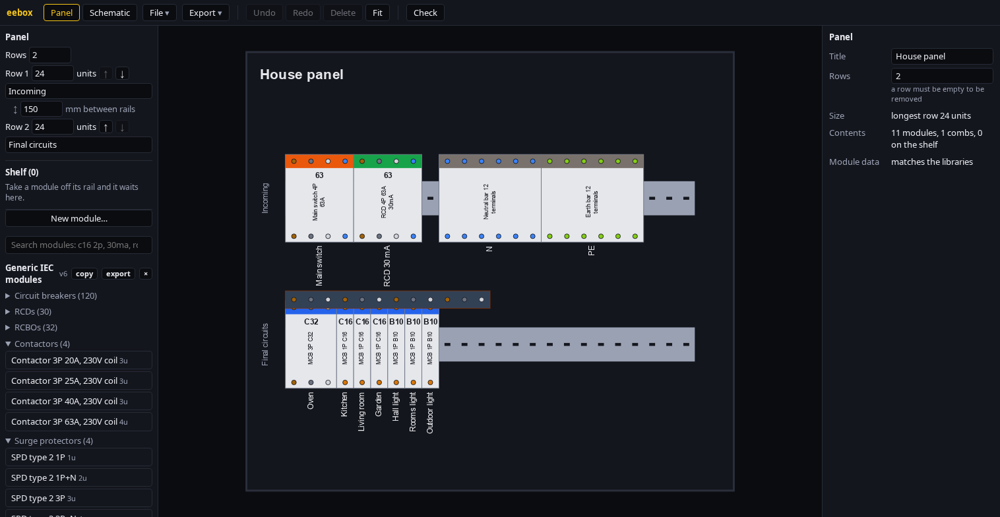
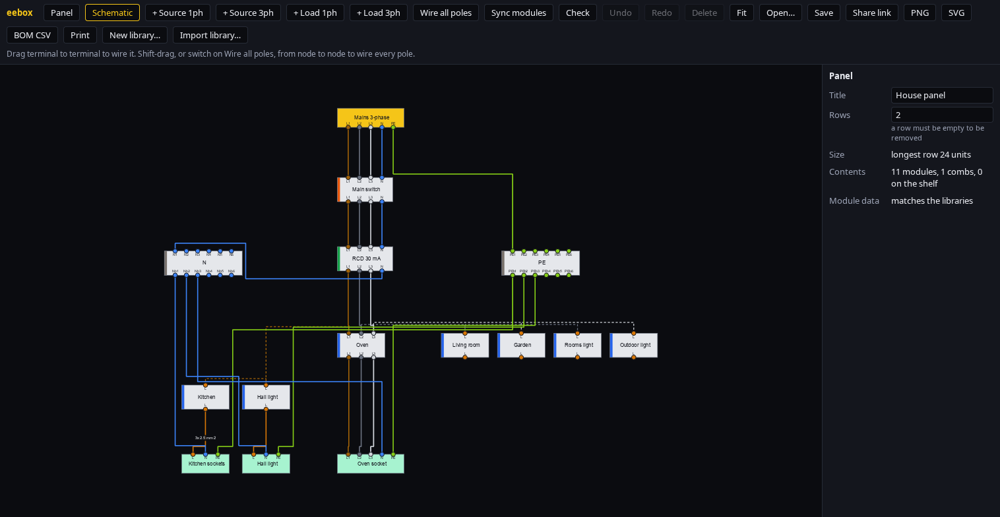
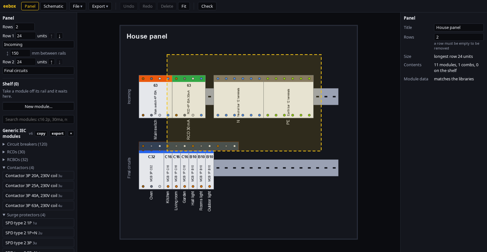
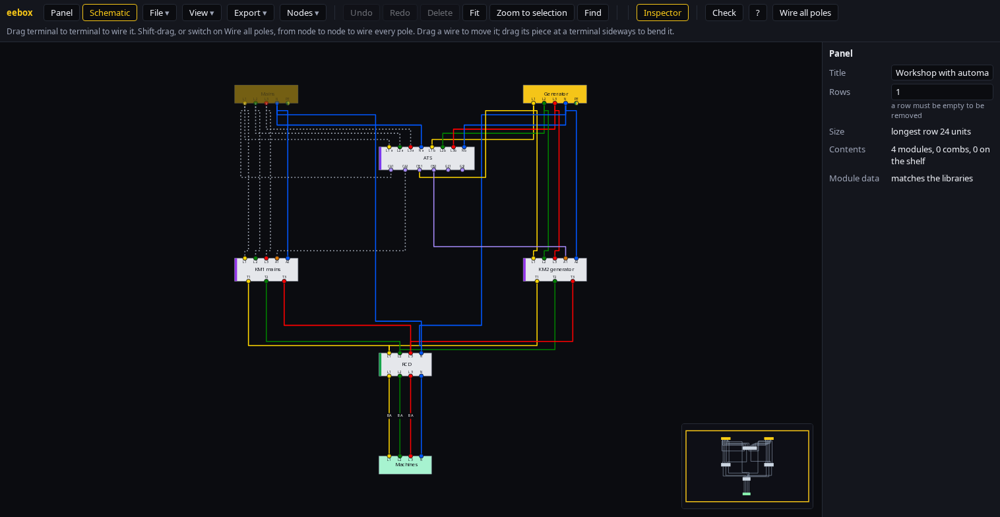
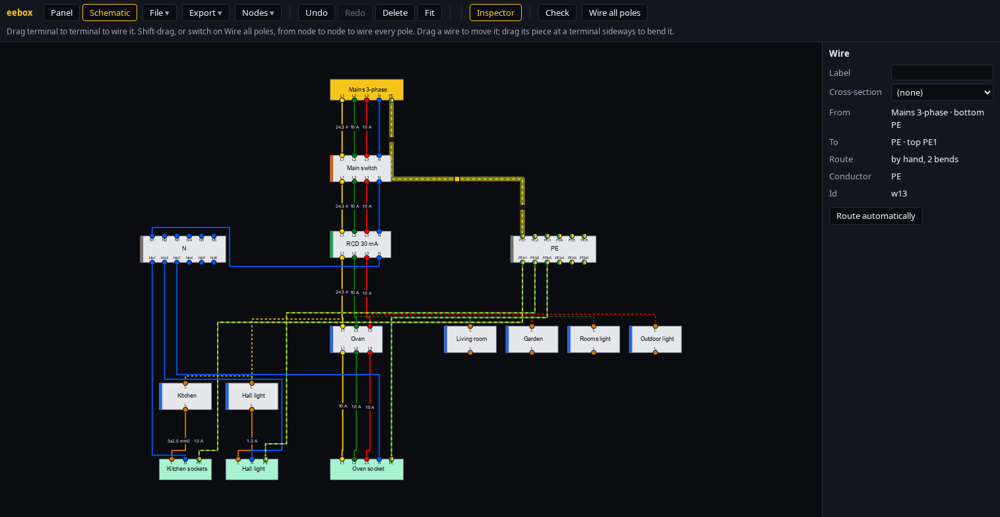
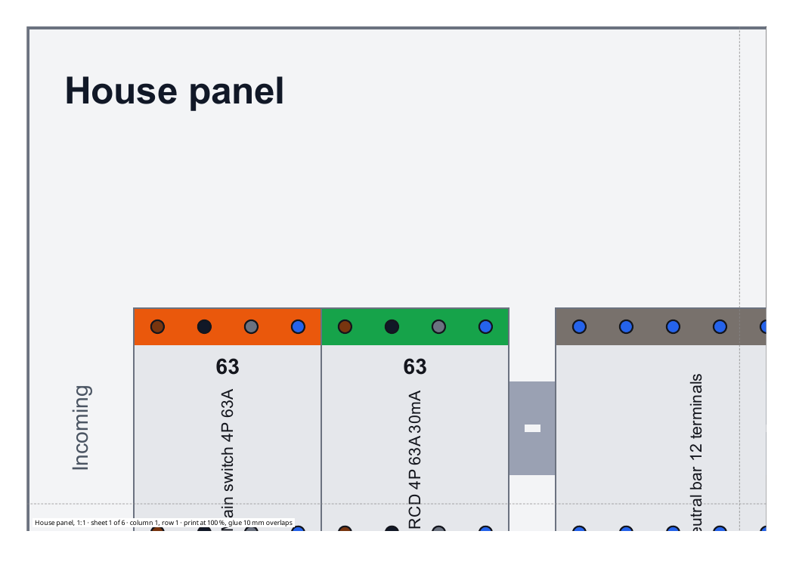
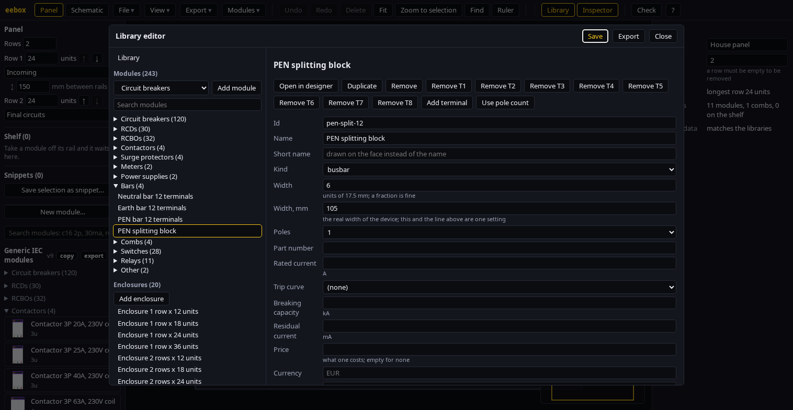

# eebox

A modular electrical panel designer that runs entirely in the browser. Lay out DIN-rail modules, comb bus bars and terminal bars on a front view of the panel, and wire them in a multi-conductor schematic that stays linked to the placed modules. There is no backend: projects live in your browser or in files, and module libraries are JSON files you bring yourself.

**Try it: https://ashevchuk.github.io/eebox/**





Shift-drag selects several modules at once and dragging one moves them all:



A transfer controller and two contactors switch a workshop to the generator when the mains go away (the mains are switched off in this picture):



## Features

- **Panel layout.** Rails of any length and spacing in 17.5 mm module units. Drag modules from the palette, reorder modules and rails, take modules off a rail onto a shelf and put them back.
- **Poles and conductors.** A module has real terminals: L, L1-L3, N, PE and PEN per pole, top and bottom, and control terminals: relay contacts (`C`), which take a wire of any kind, and 24 V DC, which cannot be wired to mains conductors. Neutral and earth bars have custom widths, comb bus bars distribute phases to the modules under them.
- **Faces of the modules.** A module can carry a drawing of its face (`art` in the library): lines, rectangles, ellipses, polylines and text that follow the width of a resizable copy by staying at the left, right or middle, stretching, or repeating as tiles, so a terminal block grows its screws with its width. The *Face* mode of the module designer draws them with the mouse: lines, rectangles, ellipses, polylines and text, moved and resized by their handles, with colours, line width, the way a shape follows the width and its place among the others set in fields, and the usual Undo. The designer turns a shape by a quarter or a half turn and flips it about its middle, and turns a text to any angle. *Export SVG* saves the face as an SVG file in millimetres, with the way each shape follows the width written in attributes of its own, and *Import SVG…* puts such a file, or any other, on the face of another module; the two together carry a drawing between modules. *Import SVG…* puts the drawing of an SVG file on the face, as lines, shapes, curves and text, shows what it would look like and says what it leaves out; the file is only read, never run. The bundled devices have faces, so a breaker, an RCD, a relay and a meter look different on the panel. The text of the drawings is set in a bundled font (Noto Sans, SIL Open Font License), which is also written into a saved SVG, so they look the same on every machine.
- **A short name for the face.** A module has a `Name` for the palette and the parts list, and may have a *Short name*, up to 16 characters, which the face shows instead, where the long name does not fit.
- **Designing a placed module.** *Edit module…* in the inspector opens the module in the designer. A bundled device cannot be changed, so the designer works on a copy in *My modules*, and when it is saved the module on the panel is given that copy, losing only the wires of terminals that the copy no longer has (it asks first); the next *Edit module…* edits the same copy. A module of your own is changed in place, and the project takes the new definition at once when nothing would be lost.
- **Earthing systems.** A source states how the supply is earthed: TN-S, TN-C-S, TN-C, TT or IT, and choosing the system in the inspector gives the source the conductors of that system (it asks before it removes wires); the system is written on the node. Check then advises when the source's conductors do not fit the system, when a PEN conductor is under 10 mm2 or passes through a switching device, and reports a short circuit where N and PE are joined without a PEN or a PEN is split a second time. A PEN is split into N and PE by a terminal block such as the bundled *PEN splitting block*; an *Earth electrode* node bonded to the PEN stands for a repeated earthing. The earth-fault loop and the first fault of an IT system are not calculated, only the phase-to-neutral loop is.
- **Wiring schematic.** Wire terminal to terminal, or wire all poles of two nodes at once. Wires obey conductor families (phase to phase, N to N, PE to PE, DC to DC; a contact terminal takes any), are routed around nodes and can carry labels.
- **Colours of the conductors.** *File > Colours...* chooses how phases, neutral and earth are drawn, on the screen, in exports and in print: the PUE colours (A yellow, B green, C red, the default), the EU ones (L1 brown, L2 black, L3 grey), or a high-contrast set for screens. Colours can be edited one conductor at a time, the earth conductor is yellow-green striped, and a colour that would be lost on its ground, black on the dark screen or yellow on paper, gets an outline. A scheme is exported to and imported from a file.
- **Routing wires by hand.** Drag a wire in the schematic to move the piece you took hold of; it moves across itself and snaps to the grid, to a gap beside a node and to a gap beside another wire, with a guide line. Drag the piece at a terminal sideways to bend the wire there. Escape cancels a drag and Undo takes it back; a wire keeps its route when its nodes move, and *Route automatically* in the inspector, or *Nodes > Route all wires automatically*, gives it back to the router. *Nodes > Separate overlapping wires* sets wires that run on top of each other, or closer than a gap, side by side. Shift-click selects several wires, and so does a Shift-drag rubber band over empty space; pulling one of them takes along the pieces of the others that run beside it, and Separate then works on the selection only. New sources are put above the schematic and new loads below it.

  
- **Marks on faults.** Wires, nodes and modules that take part in a wiring fault, among them sources of the same phase joined in parallel through closed devices, are marked in red on the drawing as you work, and what Check only advises about, such as a missing earth or wires that lie on top of each other, in amber, with the reason in the inspector of the marked item. Exports and print leave the marks out. The *Library* and *Inspector* buttons hide the panels beside the drawing, and they start hidden in a narrow window.
- **Check lists the problems.** *Check* opens a list of what is wrong, faults first, then advice, then remarks; a click on an item selects it on the drawing and brings it into view, switching between the panel and the schematic when the item is on the other one.
- **Palette.** Every module is shown with a small picture of its face. A module of *My modules* can be copied or taken out of the library from the palette (a panel that uses it keeps its own copy).
- **Help.** *?* in the toolbar lists the shortcuts, and an empty drawing says how to start.
- **The face editor with several shapes.** Shift- or Ctrl-click and a rubber band select several shapes, which move, turn, flip, align, spread out, copy and paste together, also onto another module; the drawing zooms and pans, and a rectangle or an ellipse can be turned to any angle.
- **Arranging the schematic.** Ctrl-click and a Ctrl-drag over empty space select several nodes; *Nodes > Align* and *Distribute* line them up and *Arrange nodes* lays the whole schematic out in rows from the sources to the loads.
- **Tables.** *Export > Tables...* shows the parts, circuits, wires and ferrules in the application, each column sortable.
- **Several projects, earlier states and a backup.** *File > Projects...* keeps projects in the browser next to the autosaved one: save the one on the screen over the stored copy or as a new one, open another, delete one. The application also keeps the last 12 earlier states of the project on the screen, every few minutes and before something replaces it (a new panel, an example, an opened file, a restore), listed under *Earlier states*. *File > Back up everything...* downloads one JSON file with the project on the screen, the saved projects, your own libraries, snippets and settings; *Restore from backup...* adds the projects and snippets (nothing that is stored is overwritten) and replaces libraries and settings with the same id, after asking.
- **Snippets.** *Save selection as snippet...* keeps the selected modules with the wires between them under a name; *Insert* puts them on the panel at the nearest free place, with new ids and new nodes on the schematic, and takes the module definitions along if the project does not know them.
- **Finding and moving about.** *Ctrl+F* (or *Find*) looks for a module, comb, source, load or wire by label, name, article number or id and takes you to it; *F* (or *Zoom to selection*) zooms to what is selected, and shows everything when nothing is; a minimap in the corner shows where the view is and moves it on a click or drag (*View > Minimap*).
- **Arranging modules.** The *Modules* menu packs the selected modules to the left or right, spreads them with equal gaps, puts them at the start or end of the row, and copies a whole row with its modules, combs and label.
- **Editing in the tables.** The labels and cross-sections in *Wires*, and the power, cable and length in *Circuits*, can be typed over in *Export > Tables...*; Enter moves to the next row, and a value that the inspector would refuse is refused with the same words.
- **Calculation summary.** *Export > Calculation summary...* lists each circuit with a mark for its cable, voltage drop, breaker, RCD and earth, and the reason on hover: what is wrong, and what is not known yet. It uses the cable table of *File > Cable settings*, which is not verified.
- **A tour.** A first visit starts a short tour of the views and menus; *?* has *Take the tour* for later.
- **Print.** *Export > Print...* asks which parts go on the sheet (the drawings, the lists) and the paper, A4, A3 or Letter, landscape or portrait; the browser then shows the pages.
- **Lengths.** The inspector shows the position and the width of a module in module units or in millimetres; the choice is kept.
- **Labels on everything.** Modules, rails, wires, terminals, sources, loads and the drawing itself.
- **Object inspector.** Edit the properties of whatever is selected, with validation. Changes that would remove wires ask first.
- **Loads and cables.** Give a load its power, power factor, cable length and circuit kind to see the current on every wire, from the load up to the source, the voltage drop, and the smallest cable cross-section that carries the current and keeps the drop within the limit. A cable you pick is checked against the breaker and the limit. The cable table and the norms are edited in *File > Cable settings*, a form with the table of currents, the voltage drop limits, the conductor values and the fault loop values, where changed values are outlined and a wrong cell is marked where it is; the settings are exported to and imported from a JSON file; the built-in ones are a reference only, see the limits below.
- **Power.** Set a breaker, switch or contactor to *open*, a changeover switch to input 1 or 2, or switch a source off in the inspector, and the schematic shows what loses power: wires without voltage go grey and dashed, and what they feed fades. A load's *Supplied* field says yes or no. Contactors follow their coil and voltage, phase-failure and transfer relays close their contacts when they sense voltage, so a backup supply switched by a relay shows up as live or dead; a contactor can also be forced closed or open. Impulse relays, staircase and time switches, twilight switches and on/off-delay timers have a flag you set in the inspector (output on, delay elapsed), because time is not simulated.
- **Examples.** *File > Examples...* opens a studio flat, a house panel, an entry with a PEN conductor split into N and PE, a workshop with a generator on a changeover switch and a workshop where a transfer controller and two contactors switch to the generator by themselves.
- **Supply and protection.** A source can state its short-circuit current and loop impedance; Check then warns about breakers that cannot break that current and about cables whose fault current is too low to trip their breaker at once. Both are rough: upstream cable impedance and RCDs are ignored, and the trip multiples of the curves are editable and unverified.
- **Copy and paste.** Shift-click or a Shift-drag rubber band selects several modules, and dragging one of them moves the whole selection; Ctrl+A selects all, Ctrl+C, Ctrl+V and Ctrl+D copy, paste and duplicate them with their labels and widths; Delete removes the selection. *Add copies* in the inspector places any number of copies edge to edge after the selection, which is how a row of 20 terminal clamps is made.
- **Ruler.** *Ruler* in the toolbar (or R) measures on the panel: drag from point to point and it shows the distance in mm and in module units, with its two parts. The ends snap to the edges of modules, combs, rails and the frame, so a gap between two modules reads exactly. Escape switches it off; a measurement is not saved and is left out of exports.
- **Real widths.** Widths and positions are not limited to whole units: a 22.5 mm relay is 1.2857 units and sits flush against its neighbours.
- **Parts and prices.** Import a parts list from a CSV file (*File > Import library or parts (CSV)...*). Modules can carry a price; the parts list and the print sheet total it per currency. A wire list (CSV) names both ends of every wire, and *Export > Wire end labels (CSV)* gives one label for each end of each wire (`Label 1;Label 2;Copies`, semicolons, UTF-8) to import into a label printer's software.
- **Check.** Finds overlaps, wrongly joined conductors, also those that meet only through a closed breaker, switch or contactor (L1 and L2 on the two sides of a one-pole breaker), and orphaned nodes, and warns about design problems: a load without protective earth, a module fed through its outputs only, more current drawn on one phase than a module is rated for, and loads that can be fed without passing an RCD or RCBO.
- **Module designer.** *New module...* in the sidebar draws a module and lets you place its terminals with the mouse: click the top or bottom half to add one, drag to move it, Delete to remove it, Undo and Redo to take a step back. A click can add a whole kind of terminal with its standard names (coil A1 A2, contacts 13 14, 11 12 14, supply, DC supply, sensor, a row). *Row...* adds any number of terminals to a side at once, spread evenly, and *Block...* makes a terminal block with so many on top and so many below (1 and 1, 1 and 6, 0 and 8, whatever the device has), all one point if you like. Terminals can stand anywhere along the module, not only on a whole unit, and *Spread* evens them out again. *Connect* joins two terminals inside the module, drawn as lines to a common point, and *All terminals: conductor* sets one conductor on all of them. A slider shows the module at another width and a second drawing shows it on a rail as the panel does; *Variants...* makes a copy for every rating, curve or conductor, so a block in five colours is designed once. Start from a template (breaker, contactor, relay, lighting relay, meter, pilot light, power supply, changeover switch) or from nothing; fields for the name, width, ratings and the selected terminal sit beside the drawing. Modules are kept in your own *My modules* library. *edit* on a module in the palette, or *Edit module...* in the inspector of a placed one, opens it again; a module of the bundled library is copied first.
- **Your own libraries.** Import JSON libraries, search and group the palette, update placed modules from a changed library, or write a library in the built-in editor. See [docs/library-format.md](docs/library-format.md).
- **Full-size print.** *Export > Print full size...* cuts what stands on the rails, with its labels and a margin, into overlapping A4 sheets at 1:1, on a white ground, with a dashed line where the next sheet begins, to print at 100 % and glue. The frame of the cabinet is left out and so are sheets with nothing on them.

  
- **Output.** PNG and SVG on a white ground, parts list and a list of circuits with the ferrules needed (CSV), a print sheet (panel, schematic, parts list, circuits, ferrules), labels for the modules at actual size and markers for the ends of cables, save and open project files, share links, autosave.



## Quick start

Open the page, drag modules from the palette onto a rail, switch to *Schematic* and wire them. To see a finished design, open [`examples/house-panel.json`](examples/house-panel.json) with *Open...*.

The bundled *Generic IEC modules* library is generated from standard rating series and covers breakers, RCDs, RCBOs, switches, contactors, voltage and phase monitoring relays, lighting relays, changeover switches for a backup input, a transfer controller, meters and small devices. Its widths are typical values and do not come from any manufacturer, so import your own library for real parts.

## Development

```bash
npm install
npm run dev                 # dev server
npm test                    # unit tests
npm run typecheck
npm run build:dist-file     # static build in dist-file/, opens from file://
npm run e2e                 # smoke test of the built page in Chrome or Chromium (build first)
```

There are no runtime dependencies. The code is split into a pure model (no DOM, unit-tested) and the UI on top of it; `src/library`, `src/layout`, `src/schematic`, `src/electrical` and `src/project` hold the model.

Pushes to `main` run the tests and deploy `dist-file/` to GitHub Pages.

## Limits

- The cable table (copper, PVC, 30 °C, methods B1, B2, C and E, 1.5 to 35 mm²) was compared with tables B.52.2, B.52.4 and B.52.10 of IEC 60364-5-52:2009 and matches them. The resistivity, reactance and voltage drop limits are **not verified**. Check them before relying on a cable size. There is no grouping or temperature correction and no selectivity calculation. The voltage drop is that of the final circuit only, from the panel to the load, with the simplified formula of the standard.
- Currents assume 230 V single-phase and balanced 400 V three-phase loads. Wires behind a phase bar, and wires in a loop, show no current.
- The checks are advice, not a design verification.
- A project keeps its own copy of the modules it uses, so a changed library reaches it only through *Update modules from libraries*.

## License

[MIT](LICENSE)
